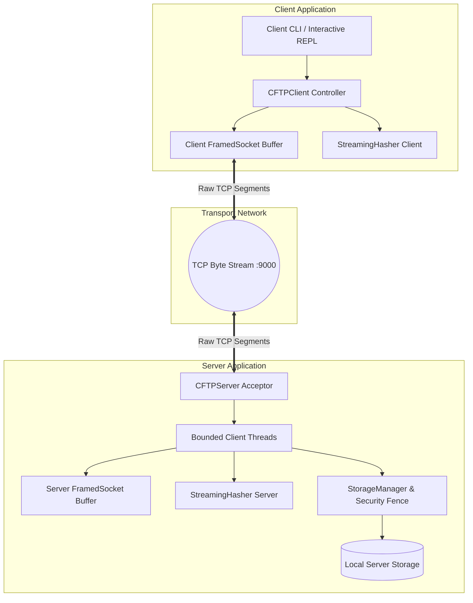

# CFTP Architecture & Component Design

**Project:** Innovative Approach to Designing and Analyzing a Custom Application Layer File Transfer Protocol over TCP  
**Document:** System Architecture & Implementation Mechanics  

---

## 1. System Overview

CFTP is structured as a modular, layered networking application built strictly on top of Python's standard library. It separates protocol parsing, TCP framing, filesystem containment, and cryptographic hashing into clear, decoupled abstractions.

---

## 2. Component Breakdown

### 2.1 Protocol Framing Engine (`cftp/protocol.py`)
- **`FramedSocket`:** The heart of the networking layer. It encapsulates a raw Python TCP `socket.socket` and maintains an internal `bytearray` buffer (`self._buffer`).
- **Delimiter Parsing:** `read_line()` accumulates incoming stream segments until a newline (`\n`) is discovered. It extracts the line, slices off the consumed bytes, and preserves unread bytes for subsequent operations without dropping or leaking data.
- **Length-Prefixed Streaming:** `stream_exact_to_file()` first drains any remaining payload bytes sitting in `self._buffer`, then reads additional chunks directly from the socket up to the exact declared byte count (`n_bytes`).
- **Memory Boundedness:** Data is streamed in chunks of 64 KB (`Config.BUFFER_SIZE`). File contents are never loaded wholly into memory, allowing arbitrarily large files (e.g., 10 GB) to be transferred with a constant memory footprint (O(1) memory).

### 2.2 Storage & Security Fence (`cftp/storage.py`)
- **Path Traversal Defense:** Prevents directory climbing attacks (`../`, `..\\`, `/etc/passwd`).
- **OS Device Name Sanitization:** Rejects Windows reserved device stems (`CON`, `PRN`, `AUX`, `NUL`, `COM1-9`, `LPT1-9`) regardless of file extension.
- **Canonical Confinement:** Uses `pathlib.Path.resolve()` to verify that the target path is strictly a descendant of `storage_dir`.
- **Atomic File Operations:** Uploads are written to `.cftp_part` staging files. The destination file is only created or replaced via `os.replace` once the full payload is received and the SHA-256 checksum has been verified. Partial or abandoned transfers are automatically purged.

### 2.3 Cryptographic Integrity (`cftp/integrity.py`)
- **`StreamingHasher`:** Wraps `hashlib.sha256()` with an incremental API (`update()`, `hexdigest()`, `bytes_processed`).
- **Dual Verification:** Both sender and receiver compute SHA-256 digests on-the-fly during socket I/O.
- **Constant-Time Comparison:** Uses `hmac.compare_digest` to prevent timing side-channel attacks during hash verification.

### 2.4 Server Core (`cftp/server.py`)
- **Socket Options:** Initializes TCP socket with `SO_REUSEADDR` to facilitate rapid server restarts without `TIME_WAIT` binding conflicts.
- **Concurrency Architecture:** Uses one `threading.Thread` per accepted client, with a default limit of 64 concurrent sessions (`--max-clients`). Each thread maintains its own `FramedSocket` instance. Finished workers are removed; shutdown closes active sockets and waits briefly for workers to finish.
- **Error Boundaries:** Catches protocol violations, socket drops, and framing errors at per-session boundaries, ensuring the main server accept loop remains resilient and stable.

### 2.5 Client Core (`cftp/client.py`)
- **Two Operating Modes:**
  1. **Interactive REPL:** Friendly terminal shell (`cftp>`) with command history, status queries, and help screens.
  2. **Scriptable CLI:** Single-command execution (e.g., `python -m cftp.client list`, `get`, `put`).
- **Detailed Transfer Metrics:** Displays elapsed time (ms), throughput (MB/s), byte counts, and hexadecimal hash verification status.

---

## 3. End-to-End Data Flow

### 3.1 File Upload (PUT)
1. Client calculates SHA-256 of local file in 64 KB chunks.
2. Client sends: `CFTP/1.0 PUT <file> SIZE=<n> CHECKSUM=<hash>\r\n`.
3. Server validates filename and ensures `<n>` is within storage limits.
4. Server replies: `CFTP/1.0 200 OK READY_FOR_DATA\r\n`.
5. Client streams `<n>` bytes; Server writes to staging file while calculating digest.
6. Server compares computed digest with client's declared checksum:
   - **Match:** Server atomically commits file and returns `200 OK TRANSFER_COMPLETE`.
   - **Mismatch:** Server deletes temporary file and returns `409 CONFLICT`.

### 3.2 File Download (GET)
1. Client sends: `CFTP/1.0 GET <file>\r\n`.
2. Server validates filename and checks existence.
3. Server opens the file once and calculates its byte count and SHA-256 digest from that descriptor. It rewinds the same descriptor for transmission, so an atomic upload replacement cannot change the selected file between hashing and streaming.
4. Server sends: `CFTP/1.0 200 OK SIZE=<n> CHECKSUM=<hash>\r\n`.
5. Client opens staging file `.cftp_part` and streams exactly `<n>` bytes from TCP socket while hashing.
6. Client compares computed digest with server's `CHECKSUM`:
   - **Match:** Client atomically replaces destination file and reports success.
   - **Mismatch:** Client unlinks temporary file and raises an integrity warning.
