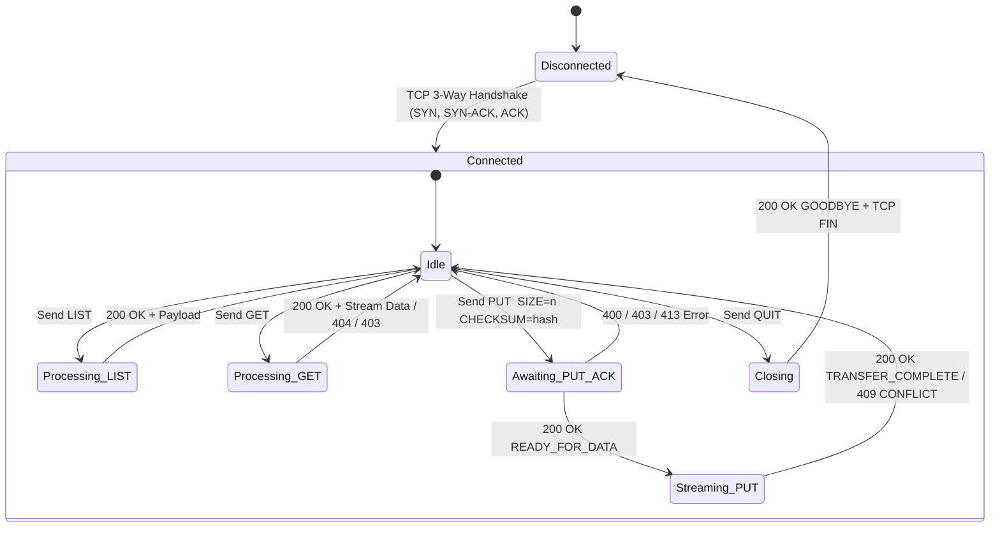
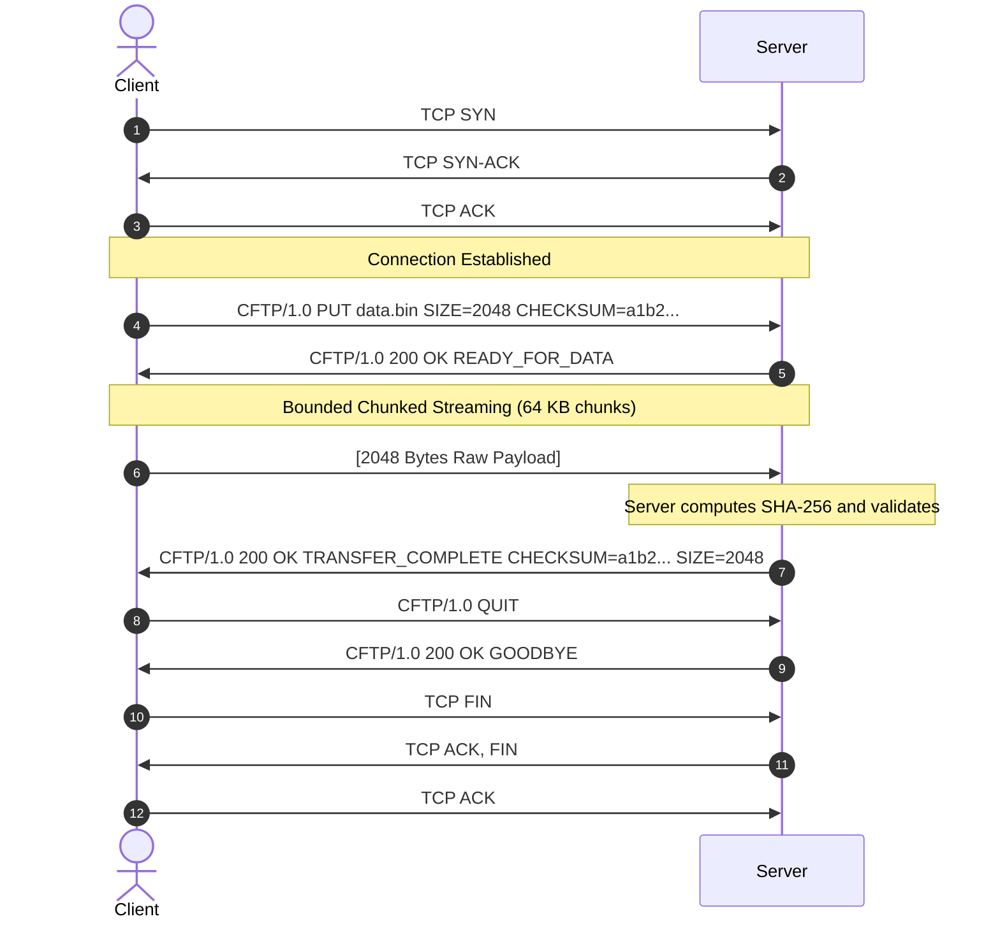

# CFTP/1.0 Protocol Specification

**Document Version:** 1.0.0  
**Project:** Innovative Approach to Designing and Analyzing a Custom Application Layer File Transfer Protocol over TCP  
**Protocol Identifier:** `CFTP/1.0`  
**Transport Layer:** Transmission Control Protocol (TCP), Default Port 9000  

---

## 1. Protocol Architecture & Overview

This implementation also supports negotiated broadcast reception, recipient ACKs,
heartbeats, and job status commands. See the [broadcast extension](broadcasts.md)
for frame boundaries, compatibility behavior, and delivery semantics.

The **Custom File Transfer Protocol (CFTP/1.0)** is an application-layer client-server protocol designed to provide reliable, framed file transfer and remote directory inspection directly over a raw TCP byte stream.

Unlike higher-level transfer systems that rely on HTTP, FTP, or remote procedure calls, CFTP specifies its own syntax, request-response negotiation, stream framing boundaries, and end-to-end cryptographic integrity verification.

```
+--------------------------------------------------------+
|          Application Layer: CFTP/1.0                   |
|   (LIST, GET, PUT, QUIT, Control Framing, SHA-256)     |
+--------------------------------------------------------+
|          Transport Layer: TCP (RFC 793)                |
|   (Reliable Byte Stream, Handshake, ACKs, Flow Control)|
+--------------------------------------------------------+
|          Internet Layer: IPv4 / IPv6                   |
+--------------------------------------------------------+
|          Link / Physical Layer: Ethernet / Wi-Fi       |
+--------------------------------------------------------+
```

---

## 2. Framing Rules & TCP Byte Stream Abstraction

### 2.1 The TCP Byte Stream Problem
TCP delivers an unstructured, continuous sequence of bytes. A single TCP segment does **not** map 1-to-1 to an application message. Under network transmission:
1. **Packet Coalescing:** Multiple small application messages may be combined into a single TCP segment (Nagle's algorithm or socket buffering).
2. **Packet Fragmentation:** A single application message or file payload may be split across dozens or thousands of TCP segments (governed by Path MTU and MSS).
3. **Delimiter Splitting:** Multi-byte delimiters (such as `\r\n`) can be bisected across consecutive `recv()` calls.

### 2.2 CFTP Dual-Framing Solution
To eliminate framing ambiguity without corrupting the stream, CFTP implements a two-tier framing model:

| Message Type | Framing Strategy | Delimiter / Boundary | Maximum Size |
|---|---|---|---|
| **Control Messages** | Delimiter-based framing | UTF-8 encoded, terminated by CRLF (`\r\n` or `\n`) | 4,096 bytes |
| **Payload Streams** | Length-prefix framing | Explicit byte count declared in header (`SIZE=<bytes>`) | Configurable (Default: 100 MB) |

#### Control Framing Rules
- Receivers buffer incoming bytes in an internal bytearray.
- When `\n` is detected, all preceding bytes (excluding trailing `\r`) are extracted and decoded as UTF-8.
- Remaining unconsumed bytes in the buffer are strictly preserved for subsequent calls.
- If the control buffer accumulates more than 4,096 bytes without finding a delimiter, the receiver rejects the message with `413 PAYLOAD_TOO_LARGE` or `400 BAD_REQUEST` to prevent memory exhaustion attacks.

#### Payload Framing Rules
- File data and directory listing payloads do **not** use sentinel characters or EOF delimiters.
- The sender declares the exact byte size via `SIZE=<bytes>`.
- The receiver drains any payload bytes already sitting in its internal buffer, and then executes chunked `recv()` calls until **exactly** `<bytes>` are accumulated.
- Zero-byte files (`SIZE=0`) complete immediately without blocking.

---

## 3. Message Syntax & Grammars

All control messages are formatted in ASCII / UTF-8 text.

### 3.1 Request Syntax
```
RequestLine = Version SP Command [SP Target] *(SP Parameter) CRLF
Version     = "CFTP/1.0"
Command     = "LIST" / "GET" / "PUT" / "QUIT"
Target      = Filename / QuotedFilename
Parameter   = Key "=" Value / Key "=" QuotedValue
CRLF        = %x0D.0A
```

### 3.2 Response Syntax
```
ResponseLine = Version SP StatusCode SP ReasonPhrase *(SP Parameter) CRLF
StatusCode   = 3DIGIT
ReasonPhrase = *(VCHAR / SP)
```

---

## 4. Status Codes & Semantics

CFTP defines a standardized 3-digit status code taxonomy:

| Code | Reason Phrase | Description |
|---|---|---|
| **200** | `OK` | Command executed successfully or transfer completed. |
| **400** | `BAD_REQUEST` | Syntax error, malformed token quoting, or missing mandatory arguments. |
| **403** | `ACCESS_DENIED` | Path traversal detected, invalid filename, or directory escape attempt. |
| **404** | `NOT_FOUND` | The requested remote file does not exist in server storage. |
| **409** | `CONFLICT` / `INTEGRITY_CHECK_FAILED` | Checksum verification mismatch or state conflict. Staged file is discarded. |
| **413** | `PAYLOAD_TOO_LARGE` | File size exceeds configured server storage limits, or control line > 4 KB. |
| **500** | `INTERNAL_SERVER_ERROR` | Uncaught server filesystem or runtime exception. |
| **501** | `NOT_IMPLEMENTED` | Command verb is unknown or unsupported by the server. |
| **505** | `VERSION_NOT_SUPPORTED` | Protocol version specified in request is not `CFTP/1.0`. |

---

## 5. Command Specifications

### 5.1 LIST
Queries the server storage directory and retrieves a structured list of available files.

- **Request:**
  ```text
  CFTP/1.0 LIST\r\n
  ```
- **Response:**
  ```text
  CFTP/1.0 200 OK COUNT=<n> SIZE=<bytes>\r\n
  <raw JSON payload of length <bytes>>
  ```
- **Payload Schema:**
  JSON array containing objects with properties: `name` (string), `size` (int), `sha256` (string), `modified` (ISO-8601 UTC string).

---

### 5.2 GET
Downloads a file from the server with SHA-256 cryptographic verification.

- **Request:**
  ```text
  CFTP/1.0 GET <filename>\r\n
  ```
- **Successful Response:**
  ```text
  CFTP/1.0 200 OK SIZE=<file_size> CHECKSUM=<sha256_hexdigest>\r\n
  <stream of exactly <file_size> raw bytes>
  ```
- **Failure Responses:**
  - `CFTP/1.0 404 NOT_FOUND MESSAGE="File not found: <filename>"\r\n`
  - `CFTP/1.0 403 ACCESS_DENIED MESSAGE="Path traversal detected"\r\n`

---

### 5.3 PUT
Uploads a file to the server using a two-phase handshake and SHA-256 verification.

- **Phase 1: Request & Parameter Declaration**
  ```text
  CFTP/1.0 PUT <filename> SIZE=<file_size> CHECKSUM=<sha256_hexdigest>\r\n
  ```
- **Phase 2: Server Admission Response**
  - If admitted: `CFTP/1.0 200 OK READY_FOR_DATA\r\n`
  - If rejected: `400 BAD_REQUEST`, `403 ACCESS_DENIED`, or `413 PAYLOAD_TOO_LARGE`
- **Phase 3: Payload Streaming**
  - Client streams exactly `<file_size>` bytes.
  - Server streams bytes into a temporary staging file (`<filename>.<pid>_<tid>.cftp_part`) while calculating SHA-256.
- **Phase 4: Integrity Verification & Commit**
  - If hash matches: Server atomically renames temporary file to target filename and responds:
    `CFTP/1.0 200 OK TRANSFER_COMPLETE CHECKSUM=<sha256> SIZE=<file_size>\r\n`
  - If hash fails: Server discards temporary file and responds:
    `CFTP/1.0 409 CONFLICT REASON=INTEGRITY_CHECK_FAILED MESSAGE="Checksum mismatch"\r\n`

---

### 5.4 QUIT
Signals orderly session termination.

- **Request:**
  ```text
  CFTP/1.0 QUIT\r\n
  ```
- **Response:**
  ```text
  CFTP/1.0 200 OK GOODBYE\r\n
  ```
- Both peers gracefully close the TCP socket via 4-way FIN termination.

---

## 6. Protocol State Transitions

### 6.1 Session State Transition Diagram



### 6.2 PUT Protocol Sequence Diagram


